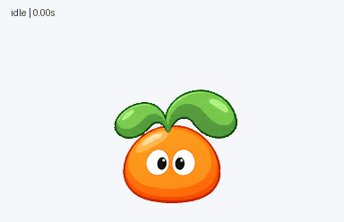
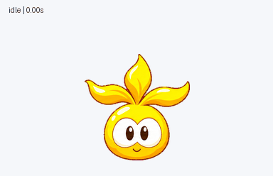
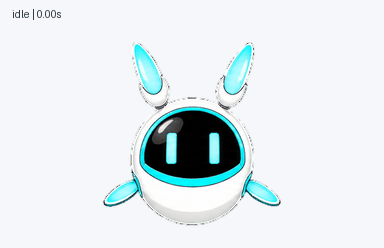

# Codex Classic Pets

[中文（默认）](README.md) · English

Bring Lahm from *Mole Manor* and Super NONO from *Seer* to your Codex desktop.

This pack includes three animated pets with blinking, greetings, jumps, and expressions for working, waiting for input, and reviewing results. You can install the finished assets without any image-generation tools.

## Meet the pets

| Classic Lahm | Classic Super Lahm · softened | Super NONO |
| --- | --- | --- |
|  |  |  |
| A round orange body with two soft green leaves. | A yellow body with three gently curved golden leaves. | A blue-and-white floating robot with cyan electronic expressions. |

These GIFs show the full state sequence. Individual states, jump transitions, direction loops, and MP4 copies are available in [previews](previews/README.md).

## Install

Download and extract the repository ZIP, or clone the repository. From its root, run:

```sh
python3 scripts/install.py all
```

To install only one pet:

```sh
python3 scripts/install.py lahm-classic-orange
```

The installer uses only the Python standard library, verifies file hashes, and **refuses to overwrite existing pets**. It does not change Codex settings, select an active pet, or download anything.

For manual installation, copy the selected complete folder from `pets/` into `~/.codex/pets/`. See [installation details](docs/installation.md) for custom data directories, Windows, and name conflicts.

After installation, choose the pet in Codex's pet picker. Restarting the app may help refresh newly added files. The entry point and animation triggers depend on the client version.

## What has been verified?

All three release sheets pass structural and resource-quality checks. Each contains nine standard animations and sixteen look directions. The installer is tested in isolated directories, without overwriting the pets you currently use.

**In-app discovery, activation, and all state triggers have not been tested in Codex.** No specific client version is advertised as fully supported yet. See [validation notes](docs/validation.md) for the test scope, retained review warnings, and NONO's packaging adjustment.

## Included files

- `pets/`: runtime `pet.json` files and transparent `spritesheet.webp` files.
- `previews/`: GIFs, MP4s, contact sheets, and stills encoded from these exact release sheets.
- `source-art/`: high-resolution base portraits for the two Lahm pets; not required to install.
- `qa/`: validation records with personal paths removed. Runtime hashes are in `checksums.json`.

## Characters and licensing

This is an unofficial character-redraw and animation pack, not an official release from the games or OpenAI. The characters originate in *Mole Manor* and *Seer*. AI-assisted redrawing does not establish ownership of the underlying characters.

The code license and grounds for public redistribution of character assets remain unresolved. Do not treat this entire pack as MIT, CC0, or unrestricted commercial-use material. See [credits](CREDITS.md) and [asset rights](ASSET_RIGHTS.md).

Local installation assets are prepared; the repository has not been publicly published. [Release readiness](docs/release-checklist.md)
