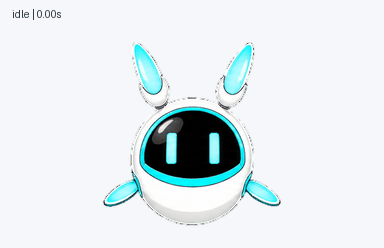

# Codex Classic Pets

中文（默认） · [English](README.en.md)

把《摩尔庄园》的拉姆和《赛尔号》的超能 NONO 带到 Codex 桌面。

这里有三款完整动画宠物：会眨眼、打招呼、跳跃，也有工作中、等待输入和查看结果的表情。下载后可以直接安装，不需要运行图片生成工具。

## 先看看它们

### 经典普通拉姆

橙色圆团子、两片软软的绿叶。


<details>
<summary>再看看跳跃和转头</summary>

跳跃衔接：


十六方向转头：


</details>

### 经典超级拉姆 · 柔化版

黄色身体、三片柔曲金叶，保留经典超拉的样子。


<details>
<summary>再看看跳跃和转头</summary>

跳跃衔接：


十六方向转头：


</details>

### 超能 NONO

蓝白色悬浮机器人、浅蓝电子表情。



<details>
<summary>再看看跳跃和转头</summary>

跳跃衔接：


十六方向转头：


</details>

GIF 展示完整状态序列。每只还有单状态预览、[跳跃衔接和十六方向预览](previews/README.md)，以及 MP4。

## 安装

下载仓库 ZIP 并解压，或 clone 仓库，然后在仓库目录运行：

```sh
python3 scripts/install.py all
```

只想安装其中一只：

```sh
python3 scripts/install.py lahm-classic-orange
```

安装工具只使用 Python 标准库，会检查文件哈希，默认**不覆盖已有宠物**。它不会改动 Codex 配置、切换当前宠物或联网下载其他内容。

不想运行脚本也可以：把 `pets/` 中所选宠物的整个目录复制到 `~/.codex/pets/`。自定义数据目录、Windows 和已有同名宠物的处理方式见 [安装说明](docs/installation.md)。

安装后，在 Codex 的宠物选择入口中选择相应名称。若新条目未出现，可以重启应用刷新。具体入口和动画触发方式取决于客户端版本。作者已在自己的 Codex 客户端中实测，反馈使用正常；[检查记录](docs/validation.md)保留了资源和安装工具的验证范围。

## 仓库里有什么？

- `pets/`：安装所需的 `pet.json` 和透明 `spritesheet.webp`。
- `previews/`：从本次发行精灵图生成的 GIF、MP4、联系表和关键帧。
- `source-art/`：两款拉姆的高清基准图，不是安装依赖。
- `qa/`：去除个人路径后的检查记录；`checksums.json` 记录运行文件哈希。

## 关于角色和许可

这是非官方的角色重绘与动画资源包，不代表原游戏或 OpenAI。角色来自《摩尔庄园》和《赛尔号》，AI 辅助重绘并不意味着我们拥有原角色的权利。

自行编写的安装脚本与测试采用 [MIT 许可证](LICENSE)。角色形象、名称及相关素材的权利归各自原权利方所有，不在这份代码许可证的授权范围内；本项目不声称已取得原作的官方授权，也不授予这些素材的商用或再分发权利。详见 [角色来源](CREDITS.md) 和 [素材权利说明](ASSET_RIGHTS.md)。

[GitHub 仓库](https://github.com/CypherHK/codex-classic-pets) · [发布记录](docs/release-checklist.md)
